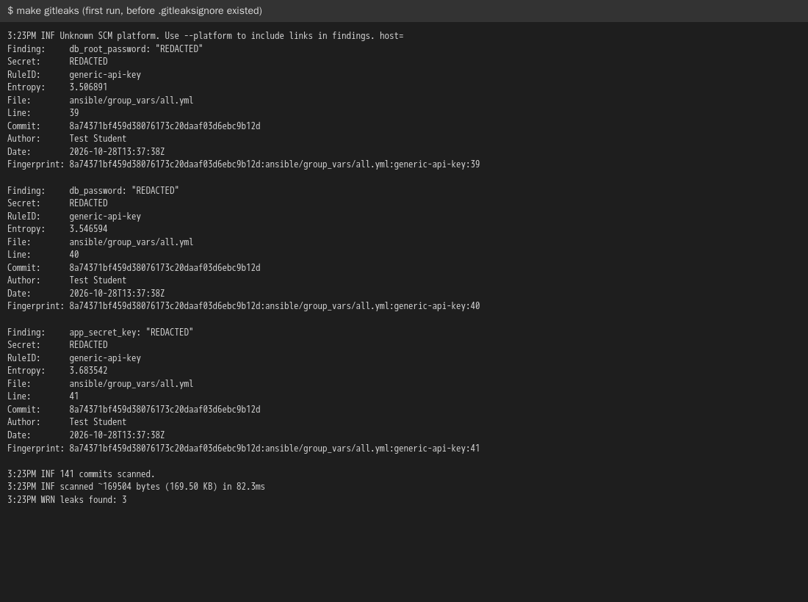
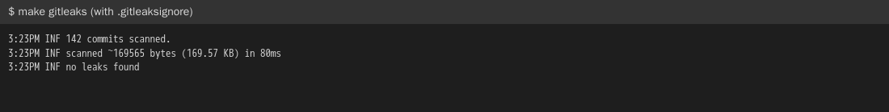
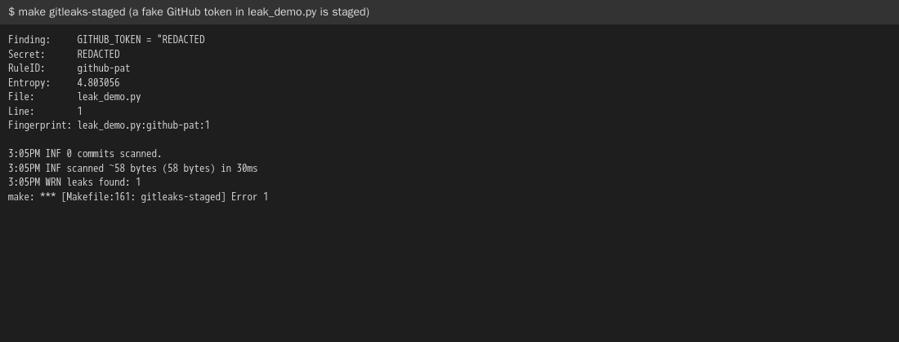

# Technical study: Gitleaks in Microblog

## 1. What Gitleaks is and what it does

[Gitleaks](https://github.com/gitleaks/gitleaks) is an open source (MIT) tool that searches git repositories, folders and
files for secrets: passwords, API keys, tokens and private keys. It has about 200 built-in rules. Most rules are regular
expressions for a known format, for example `ghp_...` for a GitHub token or `AKIA...` for an AWS key. The rule
`generic-api-key` also looks at variable names like `password`, `secret` or `key` and the entropy (how random the
value looks), so it finds home-made passwords too.

The important difference from Trivy's secret scanner, which we already run, is that Gitleaks reads the **whole git
history**, every commit, not only the files as they are now. A secret that was committed and then removed in the next
commit is still in the history, and still public if the repo has been pushed. Gitleaks finds it.

It has three ways to run:

- `gitleaks git <repo>`: all commits in the history (or a range with `--log-opts`).
- `gitleaks git --staged`: only what is staged for the next commit, made for a pre-commit hook.
- `gitleaks dir <path>`: files on disk, without git.

A finding has a fingerprint, `commit:file:rule:line`. Fingerprints listed in `.gitleaksignore` are ignored. Gitleaks
exits with code 1 when it finds something, so a CI job goes red.

## 2. How Gitleaks is used in Microblog

Gitleaks runs from its Docker image with a fixed version, like Trivy and Dockle, so it is the same tool locally, in the
dev container and in GitHub Actions. The version is set once in the `Makefile` (`GITLEAKS_IMAGE`).

### Make targets

```
make gitleaks          # the whole git history
make gitleaks-staged   # only the staged changes, used by the pre-commit hook
```

Both use `--redact`, so the secret itself is never printed in a terminal or a CI log.

### Pre-commit hook

`scripts/git-hooks/pre-commit` runs `make gitleaks-staged` and stops the commit if it finds a secret. Git does not run
hooks from the repo by itself, every group member turns it on once in their clone:

```
git config core.hooksPath scripts/git-hooks
```

To skip it once, after checking that a finding is a false-positive: `git commit --no-verify`.

### GitHub Actions

The workflow `.github/workflows/security.yml` has a job `gitleaks` next to Bandit, Trivy and Dockle. It needs
`fetch-depth: 0` in `actions/checkout`, the default is to fetch only the last commit and then Gitleaks only sees that
one. The CD workflow calls the security workflow and only publishes the image if all jobs pass.

The hook is the first line of defence, it stops the secret before it is in a commit. It is easy to skip or forget to
turn on, so the CI job is the check that is always run.

### What it found in our repo

The first run found three secrets in `ansible/group_vars/all.yml`, from commit `8a74371` in kmom02: `db_root_password`,
`db_password` and `app_secret_key`. They are throwaway test values, but they are the real passwords of the production
database, and until the security groups were fixed in this kmom port 3306 was open to the whole internet.



The fingerprints are in `.gitleaksignore`, with a comment, so that the CI job is green and catches **new** leaks. That
does not make the old ones secret again. The real fix, not done yet:

1. Choose new passwords (rotate), since the old ones are public on GitHub.
2. Remove them from `group_vars/all.yml` and send them to `ansible-playbook` with `-e db_password="$DB_PASSWORD"` from
   GitHub secrets, as the CD workflow already does with `APP_SECRET_KEY`, or encrypt them with `ansible-vault`.
3. Change the password in MySQL on the database server, it is only set when the volume is created.



A new secret is stopped before it is committed. Here a fake GitHub token is staged in `leak_demo.py`:



## 3. How Gitleaks fits in devops

DevOps wants fast feedback and automation instead of manual checks, and DevSecOps adds that security is everyone's job
and is checked early ("shift left"). Gitleaks fits both:

- **Shift left.** The cheapest place to stop a leaked secret is on the developer's computer before the commit. Once it
  is pushed it has to be treated as public, and the only fix is to rotate it, which can mean downtime and work for many
  people. Rewriting the history does not help, forks and clones keep it.
- **Automation in the pipeline.** The same check runs in CI on every push and before every release, so it does not
  depend on someone remembering to look. It gives the same red/green feedback as the tests.
- **Shared responsibility.** It is not a security team that checks the code afterwards, the developer gets the answer
  directly in the terminal.
- **Secrets management.** The tool does not solve where secrets should live. It shows when the process is broken,
  which our repo is an example of: the course said to send passwords from GitHub secrets, we put them in a file
  anyway. A tool finds the mistake, the fix is the process (secrets in GitHub secrets or a vault).

Limits: it only finds what its rules recognise, a password without a telling name (`x = "hunter2"`) passes. False
positives happen (test data, example keys), and every ignore must be explained, otherwise `.gitleaksignore` becomes a
place to hide problems. It does not replace GitHub's own secret scanning and push protection, which also checks with
the provider whether a token is valid, but those are not available for every repo type and only work on GitHub.

## Versions

Gitleaks v8.30.1 (`ghcr.io/gitleaks/gitleaks:v8.30.1`), October 2026.
